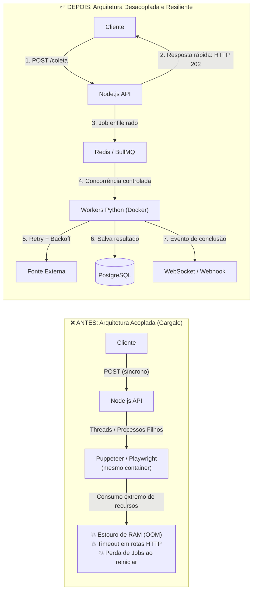
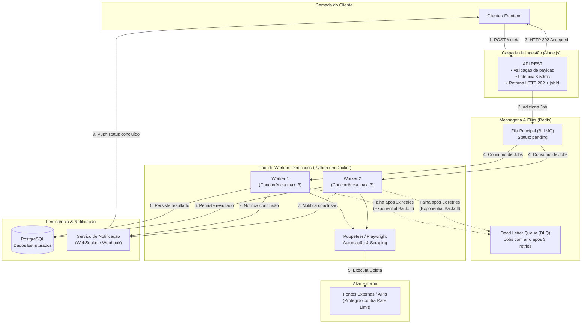

# Desafio 001: Processamento Assíncrono e Controle de Concorrência com Filas

Repositório de estudo de caso para engenharia de software de nível pleno/sênior demonstrando maturidade em arquitetura distribuída, tolerância a falhas e controle de recursos.

---

## 1. Contexto e Roteiro (Modelo STAR)

### 📌 Situação
Em um projeto recente, tínhamos um serviço responsável por coletar e processar dados estruturados de fontes externas sob demanda. Inicialmente, a própria API em Node.js disparava scripts de automação em segundo plano usando threads e processos filhos (`child_process`) para cada requisição recebida nos endpoints.

### ⚠️ O Gargalo (Problema)
Com o aumento de acessos simultâneos, o consumo de CPU e memória do container da API explodiu. Scripts com Puppeteer/Playwright consumiam recursos excessivos na mesma máquina, provocando:
* Travamentos e estouro de memória (**Out Of Memory - OOM**);
* *Timeouts* em rotas críticas e perda da experiência do usuário;
* Perda de tarefas em andamento durante os reinícios abruptos do nó;
* Bloqueios de IP nas fontes externas por ausência de controle de taxa (*rate limiting*).

### 🛠️ Ação / Solução Técnica
A arquitetura foi redesenhada desacoplando completamente a camada de ingestão da camada de processamento pesado:

1. **Ingestão e Mensageria (BullMQ + Redis):**
   * A API Node.js apenas valida a requisição, enfileira o job com status `pending` e responde imediatamente com **HTTP 202 (Accepted)** acompanhado de um `jobId`.
   * A latência do endpoint reduziu de dezenas de segundos para **menos de 50ms**.
2. **Workers Especializados (Python em Docker):**
   * Processamento isolado em containers dedicados rodando workers em Python.
   * Controle estrito de concorrência (`concurrency limit = 3` por nó) para estabilizar CPU e respeitar as taxas dos alvos.
3. **Resiliência e Tolerância a Falhas:**
   * **Exponential Backoff:** Retentativa progressiva para erros transitórios de rede e HTTP 429 (*Rate Limit*).
   * **Dead Letter Queue (DLQ):** Desvio de jobs com falhas críticas após 3 tentativas para inspeção e auditoria manual sem interromper a fila.
4. **Persistência e Notificação:**
   * Gravação dos resultados estruturados no PostgreSQL.
   * Emissão de evento via WebSocket / Webhook para notificar o cliente do término do processamento.

### 📈 Resultado
* Consumo de memória da API principal estabilizado **abaixo de 20%**.
* **Zero timeouts** HTTP causados por saturação de CPU/RAM.
* Fim da perda de dados durante falhas temporárias.
* Capacidade de escalabilidade horizontal independente (escalar apenas os nós workers quando a fila crescer).

---

## 2. Diagramas de Arquitetura

### 🔄 Comparativo: Antes vs. Depois


### 🏛️ Visão Detalhada dos Componentes


### ⏱️ Diagrama de Sequência (Ciclo de Vida da Requisição)
```mermaid
sequenceDiagram
    autonumber
    actor Cliente as Cliente / Frontend
    participant API as API Node.js
    participant Queue as BullMQ (Redis)
    participant Worker as Worker Python (Docker)
    participant Target as Fonte Externa
    participant DB as PostgreSQL
    participant DLQ as Dead Letter Queue (DLQ)

    Cliente->>API: POST /coleta (Payload)
    Note over API: Valida payload rapidamente
    API->>Queue: Enfileira Job (status: pending)
    Queue-->>API: Confirmado (jobId gerado)
    API-->>Cliente: HTTP 202 Accepted { jobId: "123", status: "pending" } (latência &lt; 50ms)

    Note over Worker,Queue: Worker consome respeitando limite de concorrência (ex: 3)
    Queue->>Worker: Entrega próximo Job disponível

    rect rgb(240, 248, 255)
        Note over Worker,Target: Execução da Automação (Puppeteer / Playwright)
        Worker->>Target: Inicia raspagem / requisição
        alt Erro transitório / Rate Limit
            Worker->>Worker: Exponential Backoff (espera progressiva e retenta)
        else Falha persistente (3 retentativas esgotadas)
            Worker->>DLQ: Desvia Job para DLQ (inspeção manual / alertas)
        else Sucesso
            Target-->>Worker: Dados brutos obtidos
        end
    end

    Worker->>DB: Salva dados estruturados processados
    Worker->>Cliente: Envia notificação de conclusão (WebSocket / Webhook)
```

---

## 3. Conceitos e Palavras-Chave de Engenharia Demonstrados
* **HTTP 202 (Accepted):** Padrão REST correto para operações assíncronas de longa duração.
* **Desacoplamento Assíncrono:** Separação estrita entre a camada de I/O web e processamento intensivo de CPU/RAM.
* **Controle de Concorrência:** Proteção contra exaustão de nós e respeito a *rate limits* externos.
* **Resiliência (Exponential Backoff & DLQ):** Tolerância a falhas transitórias com isolamento de falhas irrecuperáveis para análise.
* **Escalabilidade Horizontal Independente:** Capacidade de escalar nós de workers sem inflar custos ou instâncias da API de entrada.
