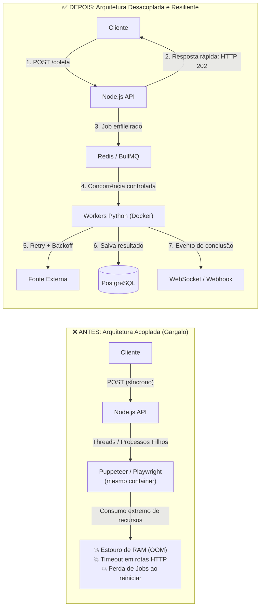
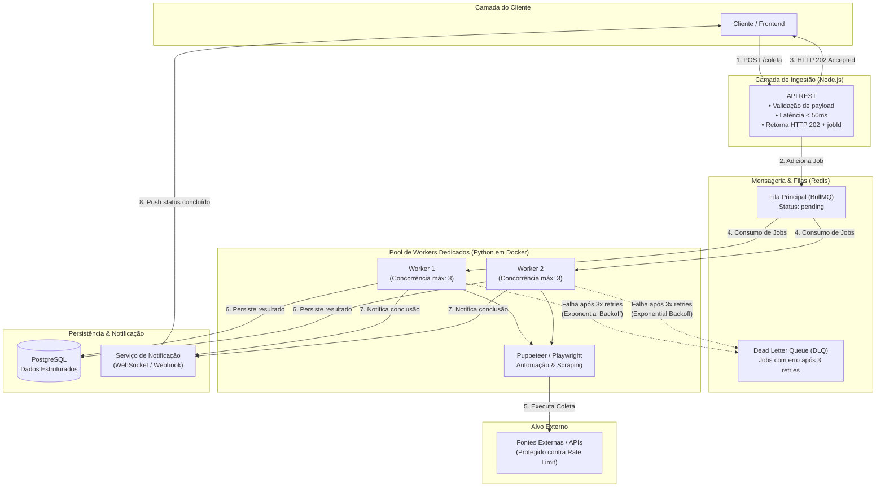

# Diagrama de Arquitetura — Desafio 001
**Cenário:** Processamento Assíncrono e Controle de Concorrência com Filas

---

## 1. Comparativo: Antes vs. Depois



---

## 2. Visão Detalhada da Nova Arquitetura



---

## 3. Diagrama de Sequência (Ciclo de Vida da Requisição)

```mermaid
sequenceDiagram
    autonumber
    actor Cliente as Cliente / Frontend
    participant API as API Node.js
    participant Queue as BullMQ (Redis)
    participant Worker as Worker Python (Docker)
    participant Target as Fonte Externa
    participant DB as PostgreSQL
    participant DLQ as Dead Letter Queue (DLQ)

    Cliente->>API: POST /coleta (Payload)
    Note over API: Valida payload rapidamente
    API->>Queue: Enfileira Job (status: pending)
    Queue-->>API: Confirmado (jobId gerado)
    API-->>Cliente: HTTP 202 Accepted { jobId: "123", status: "pending" } (latência &lt; 50ms)

    Note over Worker,Queue: Worker consome respeitando limite de concorrência (ex: 3)
    Queue->>Worker: Entrega próximo Job disponível

    rect rgb(240, 248, 255)
        Note over Worker,Target: Execução da Automação (Puppeteer / Playwright)
        Worker->>Target: Inicia raspagem / requisição
        alt Erro transitório / Rate Limit
            Worker->>Worker: Exponential Backoff (espera progressiva e retenta)
        else Falha persistente (3 retentativas esgotadas)
            Worker->>DLQ: Desvia Job para DLQ (inspeção manual / alertas)
        else Sucesso
            Target-->>Worker: Dados brutos obtidos
        end
    end

    Worker->>DB: Salva dados estruturados processados
    Worker->>Cliente: Envia notificação de conclusão (WebSocket / Webhook)
```
